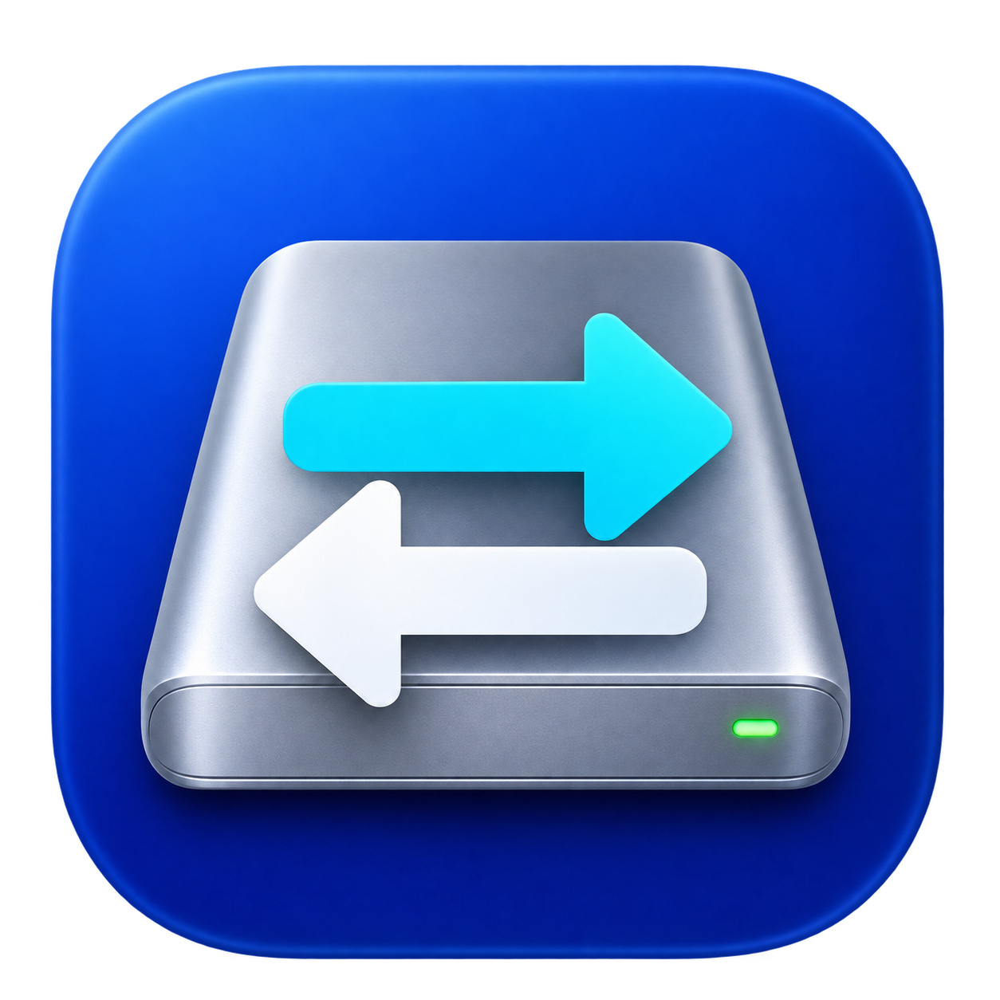

# NTFS Flow for Mac — NTFS Read & Write on macOS

**English** · [简体中文](README.zh-CN.md)

Read and write Windows NTFS drives on your Mac. **NTFS Flow** is an open-source macOS disk manager with a native SwiftUI interface and menu bar controls, powered by FUSE-T and ntfs-3g.

**macOS 14+ · Apple Silicon · SwiftUI · FUSE-T + ntfs-3g**

[Build from source](#build-from-source) · [FAQ](#frequently-asked-questions) · [Report an issue](https://github.com/476139183/NTFS-Flow-for-Mac/issues) · [中文使用说明](README.zh-CN.md)



## What you can do

- **Mount NTFS drives for read and write access** in Finder.
- Detect connected NTFS disks and display mount status and capacity.
- Unmount, return to macOS read-only mounting, or safely eject a drive.
- Manage drives from the menu bar, including bulk mount and eject actions.
- Optionally enable automatic mounting, launch at login, and a passwordless mount helper.
- Identify Windows hibernation errors, with explicit recovery options.
- Use companion shell scripts for command-line disk management and driver setup.

NTFS Flow provides the management interface; FUSE-T and ntfs-3g provide filesystem access. This repository contains application source, scripts, and icon assets. The instructions below build the app locally; they do not require a published App or DMG download.

## Requirements

| Component | Requirement |
| --- | --- |
| macOS | macOS 14 or later for the native app |
| Mac | Apple Silicon for the bundled-driver installer; the full Intel workflow is unverified |
| Build tools | Xcode Command Line Tools with Swift 5.9 or later |
| Driver setup | Homebrew, FUSE-T, and ntfs-3g |
| Permissions | Administrator approval for driver installation and privileged disk operations |

## Build from source

Clone the repository:

```bash
git clone https://github.com/476139183/NTFS-Flow-for-Mac.git
cd NTFS-Flow-for-Mac
```

Install FUSE-T and build ntfs-3g. This step uses Homebrew and requests administrator approval:

```bash
bash ntfs-setup.sh
```

Build the macOS application:

```bash
cd NTFSManager
bash build-app.sh
```

The app is created at `NTFSManager/build/NTFS Flow.app`, relative to the repository root. To build and install it in Applications:

```bash
bash build-app.sh install
```

The default build is ad-hoc signed. macOS may require you to allow the app in **System Settings → Privacy & Security** before opening it. See the [build and permissions guide (Chinese)](NTFSManager/README.md) for signing options.

## Read and write an NTFS drive

1. Open **NTFS Flow** and connect your NTFS external hard drive, SSD, or USB drive.
2. Select the drive and choose **读写挂载** (mount read/write).
3. Allow the requested macOS disk or network-volume permissions. FUSE-T exposes the local disk through a local NFS mount.
4. Open the mounted volume in Finder and copy your files.
5. Use **安全弹出** (safely eject) before disconnecting the drive.

The current application interface is in Chinese. English labels here describe the corresponding controls.

For the terminal interface, run this command from the repository root:

```bash
bash ntfs-manager.sh
```

## Frequently asked questions

### Why can my Mac read an NTFS drive but not write to it?

The built-in macOS NTFS mount is normally read-only. NTFS Flow uses FUSE-T and ntfs-3g to provide read/write mounting. You must install these drivers; building the Swift app alone does not install them.

### Is NTFS Flow a standalone NTFS driver?

It is a native macOS disk management app. It discovers volumes and coordinates mounting, unmounting, and permissions. Filesystem access comes from FUSE-T and ntfs-3g.

### Does it support Apple Silicon and Intel Macs?

The app requires macOS 14 or later. The bundled-driver installer supports Apple Silicon Macs. The complete Intel installation and mounting workflow has not been verified.

### Do I need to disable System Integrity Protection (SIP)?

The installation steps provided by this project do not require disabling SIP. Administrator approval and macOS privacy permissions may still be needed.

### Why does macOS ask for access to network volumes?

FUSE-T provides the mounted filesystem through local NFS. Check **System Settings → Privacy & Security → Files & Folders** if you previously denied access to network volumes. See the [permissions guide (Chinese)](NTFSManager/README.md) for more details.

### What if Windows hibernation prevents mounting?

Reconnect the disk to Windows, fully shut down Windows, and check the filesystem there. Force mounting removes the hibernation file and may discard an unsaved Windows session. Back up important data before recovery operations.

### Which parts are open source?

The code, scripts, and assets in this repository use the MIT license. The separately installed FUSE-T and ntfs-3g components retain their own upstream licenses. Check those terms for your use case, including commercial use or distribution.

## Development and tests

Run the unit tests without connecting an external drive:

```bash
cd NTFSManager
swift test --disable-sandbox
```

The tests cover disk error classification, per-device operation locking, disk scanning, mount resolution, subprocess execution, timeouts, and icon decoding. They do not mount, repair, or write to external drives.

`ntfs-test.sh` is a separate, manual read/write benchmark that **writes to the supplied disk image**. Use a disposable NTFS test image only:

```bash
sudo bash ntfs-test.sh /absolute/path/to/test-image.img
```

## Package a DMG

From `NTFSManager/`:

```bash
bash build-dmg.sh
```

The disk image is written to `NTFSManager/dist/`. The packaging script copies locally installed ntfs-3g binaries into the app. Review the upstream license and corresponding-source distribution requirements before sharing binary builds.

## Project structure

| Path | Purpose |
| --- | --- |
| `NTFSManager/Sources/` | SwiftUI app, disk discovery, mounting, and permissions |
| `NTFSManager/Tests/` | Unit tests |
| `NTFSManager/Resources/` | App icon, privileged helper, and driver installer |
| `ntfs-manager.sh` | Interactive command-line disk manager |
| `ntfs-setup.sh` | Driver installation and compilation |
| `ntfs-cleanup.sh` | Cleanup of other NTFS tools; inspect before running |
| `ntfs-test.sh` | Manual disk-image read/write benchmark |

## Data safety

Back up important files before changing disk mount state or repairing a volume. Prefer a full Windows shutdown and filesystem check when a disk is hibernated or marked dirty. Safely eject drives before unplugging them.

## License and acknowledgements

Application code, scripts, and assets are available under the [MIT License](LICENSE). Third-party dependencies retain their own licenses:

- [ntfs-3g, macos-fuse-t fork](https://github.com/macos-fuse-t/ntfs-3g)
- [FUSE-T](https://github.com/macos-fuse-t/fuse-t)

No precompiled third-party drivers are stored in this repository. FUSE-T is downloaded separately by the driver installer.

Design references: [ntfs-mounter-macos](https://github.com/ArrivaRUS/ntfs-mounter-macos), [Nigate](https://github.com/hoochanlon/Free-NTFS-for-Mac), and [ntfs-automount-rw](https://github.com/ggalancs/ntfs-automount-rw).

Bug reports and pull requests are welcome. When reporting a problem, include your macOS version, Mac architecture, driver versions, and the error message. Remove private volume names and file paths from logs before posting.
