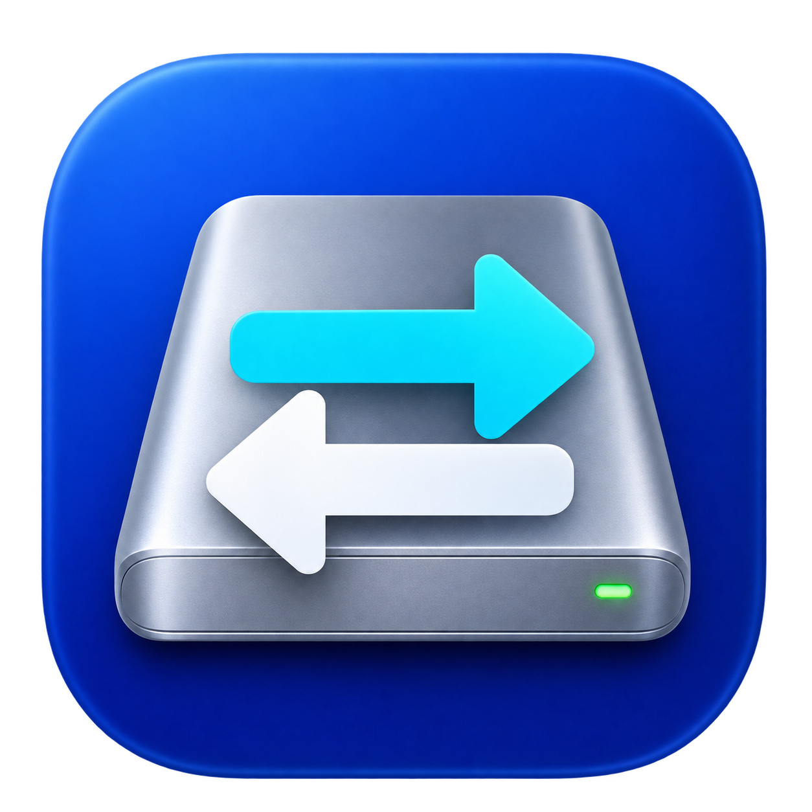

# NTFS Flow for Mac — macOS NTFS 读写工具

[English](README.md) · **简体中文**

在 Mac 上读写 NTFS 移动硬盘和 U 盘。NTFS Flow 是开源的 macOS 菜单栏磁盘管理应用，使用 Swift / SwiftUI 构建，通过 FUSE-T 和 ntfs-3g 实现 Windows NTFS 硬盘的读写挂载、卸载与安全弹出。

**适用环境：macOS 14+ · Apple Silicon · SwiftUI · FUSE-T + ntfs-3g**

[从源码构建](#从源码构建) · [常见问题](#常见问题) · [反馈问题](https://github.com/476139183/NTFS-Flow-for-Mac/issues)

当前提供源码构建方式，本文不提供已发布的 App 或 DMG 下载。



## 功能

- 自动发现 NTFS 磁盘，显示挂载状态和容量，响应磁盘插拔。
- 读写挂载、恢复系统只读挂载、卸载、安全弹出。
- 菜单栏常驻，支持批量挂载和弹出。
- 可选自动挂载、登录时启动和免密码挂载助手。
- Windows 休眠状态提示、可选强制挂载和脏卷标记修复。
- 提供命令行管理、驱动安装和测试脚本。

## 系统要求

- 原生应用：macOS 14 或更新版本，Xcode Command Line Tools（Swift 5.9 或更新版本）。
- 驱动构建：Homebrew、FUSE-T 和 ntfs-3g；安装驱动及挂载操作需要管理员权限。
- 当前应用内的驱动安装脚本仅支持 Apple Silicon。Intel 使用方式尚未验证。

## 从源码构建

```bash
git clone https://github.com/476139183/NTFS-Flow-for-Mac.git
cd NTFS-Flow-for-Mac

# 安装 FUSE-T 并从源码编译、安装 ntfs-3g，需要 Homebrew 和管理员授权。
bash ntfs-setup.sh

# 构建应用；产物为 NTFSManager/build/NTFS Flow.app。
cd NTFSManager
bash build-app.sh
```

安装到「应用程序」：

```bash
bash build-app.sh install
```

打包 DMG：

```bash
bash build-dmg.sh
```

DMG 生成在 `NTFSManager/dist/`。默认使用临时签名，首次启动可能需要在「系统设置 → 隐私与安全性」允许打开。签名和权限配置见 [应用文档](NTFSManager/README.md)。

## 使用

打开应用，插入 NTFS 磁盘后选择「读写挂载」，使用结束后点击安全弹出。首次使用时根据系统提示授权磁盘或网络宗卷访问；FUSE-T 通过本机 NFS 提供挂载。

命令行管理可在仓库根目录运行：

```bash
bash ntfs-manager.sh
```

更多说明见 [应用 README](NTFSManager/README.md) 和 [使用说明](NTFSManager/使用说明.txt)。

## 验证

不接入外置硬盘即可运行单元测试：

```bash
cd NTFSManager
swift test --disable-sandbox
```

测试覆盖错误分类、整盘互斥、磁盘扫描和挂载解析、命令执行、超时以及图标解码，不会挂载、修复或写入外置硬盘。

`ntfs-test.sh` 是另行手动运行的磁盘镜像读写测试，会向指定镜像写入数据；仅用于可丢弃的 NTFS 测试镜像：

```bash
sudo bash ntfs-test.sh /绝对路径/测试镜像.img
```

## 常见问题

### 为什么 Mac 上的 NTFS 硬盘只能读取，不能写入？

macOS 自带的 NTFS 挂载通常为只读。本应用通过 FUSE-T 和 ntfs-3g 提供读写访问；首次使用需要安装驱动，单独编译 Swift 应用不会自动安装驱动。

### 这是独立的 NTFS 驱动吗？

这是原生 macOS 磁盘管理应用，底层文件系统访问由 FUSE-T 和 ntfs-3g 提供。应用负责发现磁盘、编排挂载操作和提供窗口、菜单栏入口。

### 支持 Apple Silicon 和 Intel Mac 吗？

当前应用内的驱动安装脚本支持 Apple Silicon（M 系列芯片），应用要求 macOS 14 或更新版本。Intel 的完整使用流程尚未验证。

### 需要关闭 SIP 吗？

项目提供的安装步骤不要求关闭 SIP。驱动安装和挂载仍需要管理员授权，访问磁盘时也可能需要系统隐私权限。

### 应用和驱动使用什么许可证？

本仓库代码使用 MIT 许可证。FUSE-T 和 ntfs-3g 是独立依赖，遵循各自的上游许可；请查阅下方链接，尤其是商业使用和二进制分发场景。

## 项目结构

| 路径 | 用途 |
| --- | --- |
| `NTFSManager/Sources/` | SwiftUI 界面、磁盘扫描、挂载和权限处理 |
| `NTFSManager/Tests/` | 单元测试 |
| `NTFSManager/Resources/` | 图标、特权助手和驱动安装脚本 |
| `ntfs-manager.sh` | 命令行磁盘管理 |
| `ntfs-setup.sh` | 驱动安装和编译 |
| `ntfs-cleanup.sh` | 清理其他 NTFS 工具，使用前请检查脚本内容 |
| `ntfs-test.sh` | 手动镜像读写和速度测试 |

## 数据安全

操作磁盘前请保留重要数据备份。Windows 休眠或快速启动可能阻止读写挂载，优先回到 Windows 完整关机并检查磁盘。强制挂载会删除休眠文件，可能丢失未保存的 Windows 会话。请在拔出磁盘前安全弹出。

## 许可证与致谢

本仓库的应用代码、脚本和资源采用 [MIT License](LICENSE)。第三方驱动遵循各自许可证，不因本项目采用 MIT 而改变：

- [ntfs-3g（macos-fuse-t 分支）](https://github.com/macos-fuse-t/ntfs-3g)：以其上游许可文件为准。
- [FUSE-T](https://github.com/macos-fuse-t/fuse-t)：以其上游许可条款为准，安装时从官方下载安装包。

仓库不包含预编译的第三方驱动。`build-app.sh` 会将本机的 ntfs-3g 二进制复制到应用；分发此类构建产物时请一并检查第三方许可和对应源码的分发要求。

设计参考了 [ntfs-mounter-macos](https://github.com/ArrivaRUS/ntfs-mounter-macos)、[Nigate](https://github.com/hoochanlon/Free-NTFS-for-Mac) 和 [ntfs-automount-rw](https://github.com/ggalancs/ntfs-automount-rw)。欢迎通过 Issues 反馈问题或提交 Pull Request。
